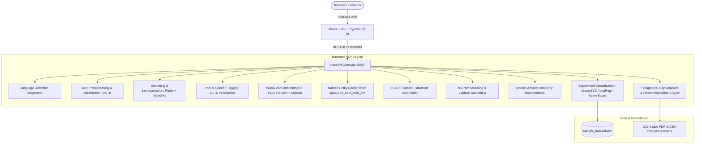
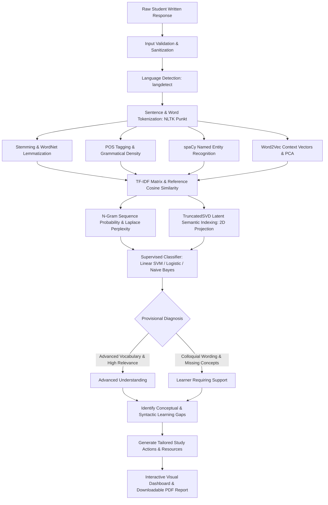

# LearnLens NLP
> **NLP-Based Early Identification of Learning Difficulties: Weak Learner vs Advanced Learner**  
> *Tagline: Understand Responses. Discover Learning Gaps. Support Every Learner.*

---

## 1. Project Overview & Objective

**LearnLens NLP** is an end-to-end educational diagnostic NLP platform designed to analyze students' written academic responses and identify linguistic, syntactic, and conceptual patterns associated with learning difficulties versus advanced understanding.

Rather than assigning permanent labels, the platform classifies responses into **"Learner Requiring Support"** and **"Advanced Understanding"**. Results are framed as **preliminary formative indicators** to assist educators in offering timely, individualized scaffolding.

The platform integrates **Practical Points 2 through 8** into a unified **Practical Point 9 Mini-Project**:
- **Practical Point 2**: Language identification, tokenization, word & sentence counts, vocabulary diversity (Type-Token Ratio).
- **Practical Point 3**: Text normalization comparing Porter Stemming vs WordNet-based Lemmatization with POS context.
- **Practical Point 4**: Penn Treebank Part-of-Speech (POS) tagging and continuous Word2Vec word embeddings projected to 2D using Principal Component Analysis (PCA).
- **Practical Point 5**: Named Entity Recognition (NER) using spaCy (`en_core_web_sm`) with character offset annotations.
- **Practical Point 6**: Term Frequency–Inverse Document Frequency (TF-IDF) feature weighting and cosine similarity against teacher model answers.
- **Practical Point 7**: N-Gram language modeling (unigrams, bigrams, trigrams), Maximum Likelihood Estimation (MLE), and Laplace add-1 smoothing.
- **Practical Point 8**: Latent Semantic Indexing (LSI) via `TruncatedSVD` to overcome synonymy and map responses in 2D latent concept space.
- **Practical Point 9 (Mini-Project)**: End-to-end integration combining all stages into an explainable diagnostic pipeline with actionable learning recommendations.
- **Practical Point 16**: Supervised Machine Learning Benchmark comparing **Multinomial Naive Bayes**, **Logistic Regression**, and **Linear Support Vector Machine (LinearSVC)**.

---

## 2. System Architecture



---

## 3. Integrated NLP Pipeline Flowchart



---

## 4. Directory Structure

```
learnlens-nlp/
├── backend/
│   ├── app/
│   │   ├── __init__.py
│   │   ├── main.py                     # FastAPI application entry point
│   │   ├── api/
│   │   │   ├── __init__.py
│   │   │   └── endpoints.py            # REST API endpoints (/api/analyze, /api/preprocess, etc.)
│   │   ├── core/
│   │   │   └── __init__.py
│   │   ├── data/
│   │   │   └── sample_dataset.csv      # Curated benchmark dataset (28 academic rows)
│   │   ├── schemas/
│   │   │   ├── __init__.py
│   │   │   └── nlp_schemas.py          # Pydantic schemas for all pipeline stages
│   │   └── services/
│   │       ├── __init__.py
│   │       ├── preprocessor.py         # Practical 2 & 3: Tokenization, Stemming, WordNet
│   │       ├── pos_embeddings.py       # Practical 4: POS tagging, Word2Vec, 2D PCA
│   │       ├── ner_service.py          # Practical 5: spaCy NER with character spans
│   │       ├── tfidf_service.py        # Practical 6: TfidfVectorizer, cosine similarity
│   │       ├── ngram_service.py        # Practical 7: Unigram/Bigram/Trigram, Laplace smoothing
│   │       ├── lsi_service.py          # Practical 8: TruncatedSVD LSI 2D projection
│   │       ├── classifier_service.py   # Practical 16: SVM, Logistic Regression, Naive Bayes
│   │       ├── dataset_service.py      # Practical 15: CSV parsing & summary
│   │       └── gap_analyzer.py         # Practical 14: Learning gap heuristics
│   └── requirements.txt
│
├── frontend/
│   ├── src/
│   │   ├── components/
│   │   │   ├── Sidebar.tsx             # 14-tab persistent sidebar navigation
│   │   │   ├── Header.tsx              # Header with health status & quick actions
│   │   │   └── ExplainCard.tsx         # "How was this calculated?" / "Why does this matter?"
│   │   ├── pages/
│   │   │   ├── DashboardPage.tsx       # KPI summary, pie/bar/line charts, recent table
│   │   │   ├── AnalyzeAnswerPage.tsx   # Interactive evaluation form with 18 result cards
│   │   │   ├── StudentPerformancePage.tsx # Longitudinal tracking & individual trajectories
│   │   │   ├── PipelinePage.tsx        # Interactive 12-stage pipeline diagram
│   │   │   ├── PreprocessingPage.tsx   # Practical 2 & 3: Word/sentence tokens, stem/lemma
│   │   │   ├── PosEmbeddingsPage.tsx   # Practical 4: POS chart & Word2Vec PCA scatter
│   │   │   ├── NerPage.tsx             # Practical 5: spaCy entity highlighting & frequencies
│   │   │   ├── TfidfPage.tsx           # Practical 6: TF-IDF weights & vector heatmap
│   │   │   ├── NgramPage.tsx           # Practical 7: Transition probabilities & Laplace
│   │   │   ├── LsiPage.tsx             # Practical 8: TruncatedSVD 2D document scatter
│   │   │   ├── ModelComparisonPage.tsx # Practical 16: MNB vs LogReg vs SVM comparison
│   │   │   ├── DatasetExplorerPage.tsx # Practical 15: CSV upload, schema audit, preview
│   │   │   ├── ReportsPage.tsx         # Practical 19: PDF generation & CSV export
│   │   │   └── AboutMethodologyPage.tsx# Practical 18: In-depth technical justifications
│   │   ├── services/
│   │   │   └── api.ts                  # Fetch API client connecting to FastAPI backend
│   │   ├── types/
│   │   │   └── index.ts                # TypeScript interfaces for all domain responses
│   │   ├── App.tsx                     # Main layout & router shell
│   │   ├── index.css                   # Custom theme (lavender background, navy headings)
│   │   └── main.tsx
│   ├── index.html
│   ├── package.json
│   ├── tsconfig.json
│   └── vite.config.ts
└── README.md
```

---

## 5. Setup & Execution Instructions

### Prerequisites
- **Python**: Version 3.10 or 3.11
- **Node.js**: Version 18 or higher (tested with Node v24)
- **npm**: Version 9 or higher

### Step 1: Backend Setup
Open a terminal in `backend/`:
```bash
cd backend
python -m pip install -r requirements.txt
```

Download required NLTK corpora and spaCy English model:
```bash
python -c "import nltk; nltk.download('punkt'); nltk.download('punkt_tab'); nltk.download('averaged_perceptron_tagger'); nltk.download('averaged_perceptron_tagger_eng'); nltk.download('wordnet'); nltk.download('stopwords'); nltk.download('omw-1.4')"
python -m spacy download en_core_web_sm
```

Start the FastAPI backend server:
```bash
python -m uvicorn app.main:app --host 127.0.0.1 --port 8000 --reload
```
The backend API will be live at `http://127.0.0.1:8000`. Interactive OpenAPI documentation is accessible at `http://127.0.0.1:8000/docs`.

### Step 2: Frontend Setup
Open a second terminal in `frontend/`:
```bash
cd frontend
npm install
npm run dev
```
Open `http://127.0.0.1:5173` in any web browser.

---

## 6. Demonstration Workflow for College Practical Examination

During a viva or practical examination, follow this 5-minute demonstration:

1. **Dashboard Overview (Tab 1)**:
   - Point out the KPI summary cards showing actual counts from `sample_dataset.csv`.
   - Demonstrate the response category doughnut chart, complexity vs relevance bar chart, and recent responses table.
2. **Interactive Answer Evaluation (Tab 2)**:
   - Click the preset demo button **"Biology: Advanced Understanding"** to populate question, reference answer, and student response.
   - Click **"Analyze Response"**.
   - Show how the backend executes all NLP practicals in real-time.
   - Point out the 18 result cards, expanding **"How was this calculated?"** and **"Why does this matter?"**.
   - Click **"Download Official Report (PDF)"** to download the clean PDF audit report.
3. **Compare with a Struggling Response**:
   - Click **"Biology: Requiring Support"** (`"Plants eat sun and water then green stuff gives food and air..."`).
   - Click **"Analyze Response"**.
   - Contrast the diagnostic category (**"Learner Requiring Support"**), lower TTR, high colloquial trigger flags, and targeted recommendations to review chloroplast mechanisms.
4. **Individual NLP Practicals Inspection**:
   - **Tab 5 (Preprocessing)**: Test stemming vs lemmatization with words like *"studying"*, *"studies"*, *"better"*.
   - **Tab 6 (POS & Embeddings)**: Show the noun-to-verb ratio and the 2D PCA spatial Word2Vec scatter.
   - **Tab 7 (NER)**: Show spaCy extracting named entities with category spans.
   - **Tab 8 (TF-IDF)**: Explain the formula $TF\text{-}IDF(t,d) = TF(t,d) \times IDF(t)$ and the matrix heatmap.
   - **Tab 9 (N-Gram)**: Inspect conditional bigram probabilities $P(w_i | w_{i-1})$ and Laplace add-1 smoothing.
   - **Tab 10 (LSI)**: Show TruncatedSVD reducing dimensions and document proximity in latent space.
5. **Model Evaluation & Ethical Transparency (Tabs 11 & 14)**:
   - **Tab 11**: Review held-out accuracy, precision, recall, F1, and confusion matrices across Naive Bayes, Logistic Regression, and Linear SVM.
   - **Tab 14**: Show the ethical framing explaining why the platform avoids permanent "weak learner" labeling.

---

## 7. Ethical Framing & Educational Disclaimer

> **Important Pedagogical Notice**:
> The results produced by LearnLens NLP are preliminary formative indicators derived from statistical and lexical NLP patterns. They are **NOT** definitive measures of a student's innate intelligence, psychological profile, or long-term potential. Teachers must exercise human professional judgment before designing targeted academic support.
